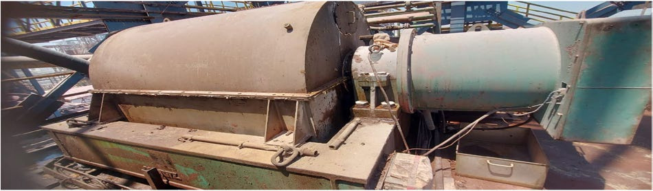

# Industrial Centrifuge Vibration Forecasting



Forecast the vibration of an industrial Sulzer centrifuge ten minutes ahead from a thirty-minute window of sensor readings. The system compares recurrent neural networks, tracks experiments with MLflow, and serves the validation-selected LSTM with NVIDIA Triton.

## Project at a glance

- **Task:** regression forecasting, not fault classification.
- **Input:** 30 consecutive minutes × 4 sensor signals, shape `(30, 4)` per sample.
- **Target:** one vibration RMS value at `t + 10 minutes`, shape `(1,)`.
- **Models:** a simple RNN and an LSTM, each with four inputs per timestep, hidden size 32, and one output.
- **Selected model:** LSTM, selected by validation MAE.
- **Serving:** ONNX model loaded by Triton in Docker; inputs are normalized with training statistics and outputs are returned in `mm/s RMS`.

## Dataset

The CFG-42 dataset contains approximately one year of one-minute measurements from a Sulzer industrial centrifuge at Arab Potash Company in Jordan. The collection system is an ABB 800xA DCS. Dataset provenance and license information are in `data/raw/README_metadata (1).txt` (CC BY 4.0).

The four input signals are ordered as follows in every sample and inference request:

| Position | Signal | Meaning | Unit |
|---:|---|---|---|
| 0 | `Analogue_Signals.30-VI-3274-A` | Vibration | mm/s RMS |
| 1 | `Analogue_Signals.30-NI-3271-A` | Torque/load | % nominal load |
| 2 | `Analogue_Signals.30-TI-3273` | Solid-end bearing temperature | °C |
| 3 | `Analogue_Signals.30-TI-3275` | Liquid-end bearing temperature | °C |

The raw CSV is intentionally excluded from Git. `data/raw/CFG_42_EDS_Data-_1_.csv.dvc` records its MD5 hash and size, but this repository has no shared DVC remote. A fresh checkout therefore needs the CSV placed at `data/raw/CFG_42_EDS_Data-_1_.csv` before training or running the PyTorch/Triton parity script. The committed ONNX model can be served without the CSV.

## Data preparation and split

`datasets/sulzer.py` parses timestamps, converts sensor columns to numeric values, reconstructs the one-minute timeline, and rejects duplicate timestamps. Exact zero values in temperature B are treated as missing. A valid sample requires all four signals for each of the 30 input minutes and an observed vibration target exactly ten minutes after the input window. The nine intervening minutes are not used as target rows.

The data is split chronologically, and windows do not cross split boundaries:

| Split | Time interval |
|---|---|
| Train | Before 2023-05-18 00:00 |
| Validation | 2023-05-18 00:00 through 2023-07-11 23:59 |
| Test | From 2023-07-12 00:00 onward |

Mean and population standard deviation (`ddof=0`) are calculated on the training split only. Those same values normalize train, validation, and test. This avoids using future data to fit preprocessing statistics. The current training run had 290,543 train windows and 40,241 validation windows after filtering.

## Models and training

Both models process tensors shaped `(batch, 30, 4)` with `batch_first=True`. The RNN summarizes sequence context with a hidden state. The LSTM adds a cell state and learned gates that regulate what information to retain. A linear layer maps the final timestep's hidden representation to one normalized vibration value.

Training uses normalized-target MSE and AdamW. The CLI defaults are:

| Parameter | Default |
|---|---:|
| Model | `lstm` |
| Maximum epochs | 10 |
| Batch size | 64 |
| Learning rate | 0.001 |
| Hidden size | 32 |
| Seed | 42 |
| Weight decay | 0.0001 |

Early stopping monitors validation MAE in physical units (`mm/s RMS`) with patience 6 and `min_delta=0.001`. The checkpoint with the best validation MAE is restored before saving. The test loader is not evaluated by `train.py`; the final test evaluation described below was performed separately after model selection.

### Baseline and results

The `repeat-last` baseline predicts that vibration ten minutes later equals the last vibration in the input window. It is evaluated on the same split and in the same physical units as model MAE.

| Model/metric | Validation MAE (mm/s RMS) | Test MAE (mm/s RMS) |
|---|---:|---:|
| Repeat-last baseline | 0.3001 | 0.3960 |
| RNN | 0.2895 | Not evaluated |
| LSTM selected by validation | **0.2822** | 0.4286 |

The LSTM was selected because it had the lowest validation MAE. It did **not** beat repeat-last on the later test period. This is an important generalization limitation; the project does not claim that the neural model outperforms the baseline on future data. The existing test result is final for the selected LSTM; do not use this test split to tune later models.

The LSTM's best validation MAE occurred at epoch 5. Validation MAE did not improve in epochs 6–10, which was the configured epoch cap. The RNN's best validation MAE occurred at epoch 1 and it early-stopped at epoch 7.

### Learning-curve plots

Each new MLflow training run includes a two-panel PNG:

1. Training and validation **normalized MSE** overlaid on the same axis.
2. Validation **MAE in mm/s RMS** with the repeat-last baseline, because these are directly comparable in physical units.

The run `78a9fe854ee94dd3ab80dd34b8502b7a` was created to log these plots using train/validation only; it has no test metric. The original selected/test-evaluated LSTM run remains `2900d1cab6184fc9a2b2359b47f4c953`. They are separate runs and should not be conflated.

## MLflow

The experiment is named `sulzer-vibration-forecasting`. Training runs record model parameters, train/validation metrics, baseline MAE, best validation MAE, and checkpoint artifacts. The plotting branch also records normalized validation MSE and the learning-curve PNG.

Compose runs an MLflow server with a local SQLite backend and artifact storage under `mlruns/`. Open the UI at <http://localhost:5000>. The `mlruns/` directory is ignored by Git, so these run IDs and their checkpoint artifacts are local to the development checkout unless the MLflow store is transferred separately.

## Triton inference

The validation-selected LSTM checkpoint was exported to `serving/model_repository/sulzer_lstm/1/model.onnx`. The export wrapper embeds the train-split means and standard deviations: Triton accepts raw sensor values, applies normalization, predicts normalized vibration, and returns the result de-normalized to `mm/s RMS`.

The Triton model is named `sulzer_lstm`, uses input `RAW_WINDOW` with shape `[batch, 30, 4]`, and returns `PREDICTED_VIBRATION` with shape `[batch, 1]`. Compose exposes HTTP on port 8000, gRPC on 8001, and metrics on 8002.

The demo request uses the real window from 2023-05-18 13:31 through 14:00 and forecasts 14:10. The PyTorch and Triton predictions were both `4.328803539 mm/s RMS` (absolute difference 0). This sample is from validation, not test. The committed ONNX model can be served directly. Re-exporting or running `serving.verify_triton` also requires the local raw CSV and the selected PyTorch checkpoint in the ignored MLflow artifact store.

## Quick start

### Install dependencies

Use Python 3.11. The training image pins a CUDA 13 PyTorch build; GPU use also requires a compatible NVIDIA driver, Docker GPU support, and NVIDIA Container Toolkit.

```bash
python -m pip install -r requirements.txt
python -m pip install -r requirements-dev.txt
```

Make sure the raw CSV is present at `data/raw/CFG_42_EDS_Data-_1_.csv` before training. There is no configured DVC remote in this repository.

### Run tests

```bash
python -m pytest -v
pre-commit run --all-files --verbose
```

There are four tests: three model output/shape checks and one plot-generation check. Pre-commit runs pytest locally; this repository does not configure a GitHub Actions CI workflow.

### Train and track a new model

Build the training/MLflow image, start MLflow, then choose either architecture with the Compose training service:

```bash
docker compose build train mlflow
docker compose up -d mlflow
docker compose run --rm train --model rnn --epochs 10
docker compose run --rm train --model lstm --epochs 10
```

Other CLI options include `--batch-size`, `--learning-rate`, `--hidden-size`, and `--seed`. Training uses train and validation; it does not automatically evaluate test. Each invocation creates a new MLflow run and may overwrite the corresponding local file under `artifacts/`.

### Serve the committed LSTM with Triton

```bash
docker compose up -d mlflow triton
docker compose ps
curl -i http://localhost:8000/v2/health/ready
curl -i http://localhost:8000/v2/models/sulzer_lstm/ready
```

For an actual HTTP inference request and PyTorch parity check, run from the repository root in an environment with the project dependencies and local MLflow checkpoint available:

```bash
python -m serving.verify_triton
```

This verification script currently uses the May 18 sample. To stop the services afterward:

```bash
docker compose down
```

## Repository map

| Path | Purpose |
|---|---|
| `datasets/sulzer.py` | Timestamp parsing, preprocessing, temporal splits, window construction, and DataLoaders |
| `models/rnn.py` | RNN and LSTM forecasters |
| `engine/trainer.py` | Training, validation metrics, baseline, and history collection |
| `callbacks/early_stopping.py` | Selects and restores best validation weights |
| `train.py` | Training CLI and MLflow logging |
| `serving/` | ONNX export, Triton model repository, and inference parity client |
| `notebooks/eda.ipynb` | Exploratory data analysis |
| `test/` | Pytest checks |
| `data/raw/*.dvc` | DVC metadata for the raw dataset |

## Scope and limitations

- Triton inference is demonstrated locally; there is no production deployment, online monitoring, or plant-control integration.
- There is no shared DVC remote configured. The DVC pointer identifies the expected dataset version but does not make the CSV downloadable from a fresh clone.
- The test result shows the selected LSTM does not beat repeat-last on the held-out period. Any future model tuning should use new validation/backtesting periods and a new untouched test period.
- The RNN was not evaluated on test because the LSTM was selected using validation.
